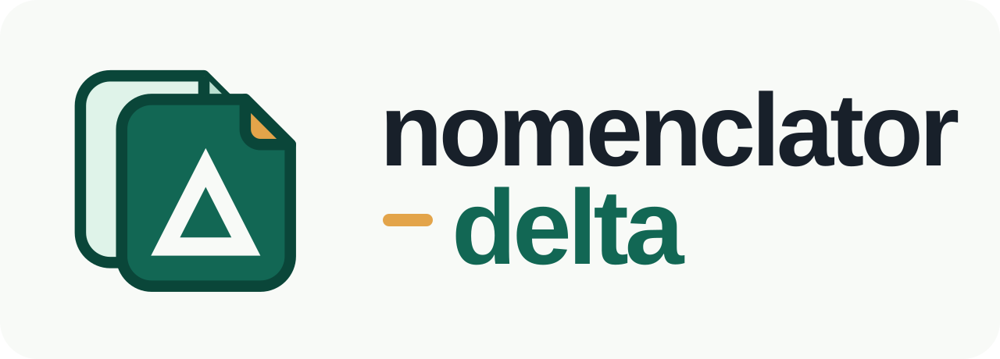

  
  
<em>Compare monthly changes in Spain's National Health System list of medicines and health products</em>

  

    
    
    
    
  

  

    <a href="https://mrueda.github.io/nomenclator-delta/app/"><strong>Open the app</strong></a>
    ·
    <a href="https://mrueda.github.io/nomenclator-delta/"><strong>Read the documentation</strong></a>
  

`nomenclator-delta` compares available monthly releases of the Ministerio de
Sanidad's *Nomenclátor de Facturación*: its database of medicines and health
products included in the Sistema Nacional de Salud (SNS) pharmaceutical benefit
and dispensed through community pharmacies. Find changes by Código Nacional,
medicine name, active ingredient, or laboratory—without an account.

The app is in Spanish; documentation and source code are in English.

## Start here

- [Using the app](https://mrueda.github.io/nomenclator-delta/docs/usage/quickstart)
- [Understanding changes and limitations](https://mrueda.github.io/nomenclator-delta/docs/usage/reading-changes)
- [Monthly updates](https://mrueda.github.io/nomenclator-delta/docs/operations/monthly-update)
- [Local setup and CLI](https://mrueda.github.io/nomenclator-delta/docs/reference/cli)
- [Essential data notes](DATA_NOTES.md)

This independent project is not affiliated with the Ministerio de Sanidad.
It reports differences, not clinical or dispensing advice. The
[official Nomenclátor](https://www.sanidad.gob.es/profesionales/nomenclator.do)
remains authoritative.

## License

[MIT](LICENSE) © 2026 Manuel Rueda.
